# SP Architect

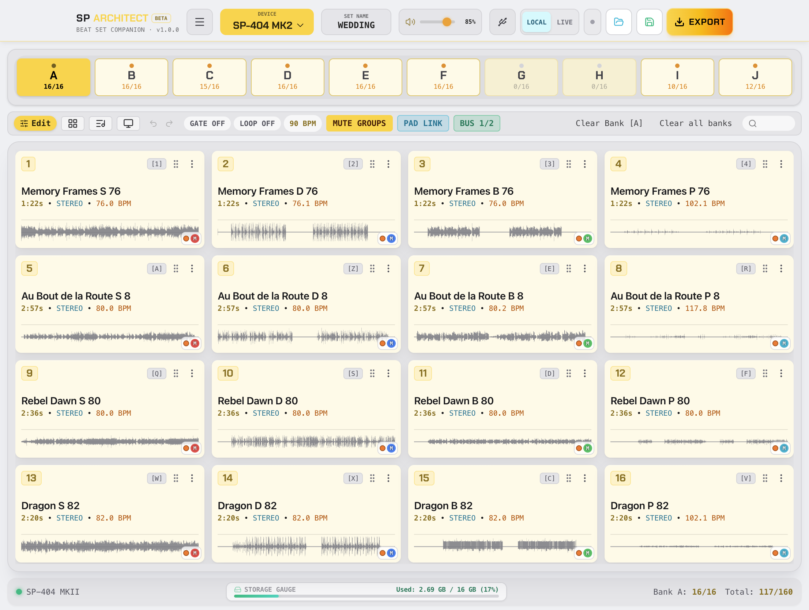

**Beat-set and live-set manager, sample librarian for the iconic Roland SP-303, SP-404 (OG), SP-404SX / A, SP-404MK2 and SP-555.**

[**Website**](https://sound-sculpture.github.io/SP-Architect-releases/) ·
[**Download the latest build**](https://github.com/sound-sculpture/SP-Architect-releases/releases/latest) ·
[**Report a bug**](https://github.com/sound-sculpture/SP-Architect-releases/issues)

SP Architect lets you build a set on your computer, edit every pad parameter, convert audio to each machine's proprietary format, and write it to a card folder, a ZIP or a project file. No account, no cloud, no telemetry: everything runs locally.

## Install

- **macOS 11+** — open the DMG, drag *SP Architect* to **Applications**, launch it. Signed and notarised: no warning.
- **Windows 10/11 x64** — unzip anywhere, run `SP Architect.exe`. Unsigned: click **More info → Run anyway** the first time.
- **iPad** — TestFlight beta, coming soon.

> Roland and Boss are trademarks of their respective owners. SP Architect is **not affiliated with or endorsed by Roland or Boss**. Always back up your cards before writing anything, and use the app at your own risk.

## Downloads

> GitHub adds *Source code (zip/tar.gz)* archives to every release. They only
> contain the documentation of this repository — **no application source code**.
> The source code is not published.

Binaries are published in the [Releases](https://github.com/sound-sculpture/SP-Architect-releases/releases) tab.

**Latest: [1.0.0-beta.7](https://github.com/sound-sculpture/SP-Architect-releases/releases/tag/v1.0.0-beta.7)**

- **macOS 11+** — `SP-Architect-macOS-universal.dmg` (universal, notarised and stapled).
- **Windows 10/11 x64** — `SP-Architect-Windows-x64-portable.zip` (portable, unsigned: SmartScreen warns, click *More info → Run anyway*).
- **iPad** — TestFlight beta (build `1.0.0 (2)`); the public link is published on the site once Apple has approved the build.

The source code is not published.

## Screenshots

Real captures from the app, each module on a real card or project.

| | |
|---|---|
|  | **SP-404MK2** — a live set loaded from a project: pad names, levels, tempo per pad, bus, mute and link groups. |
| 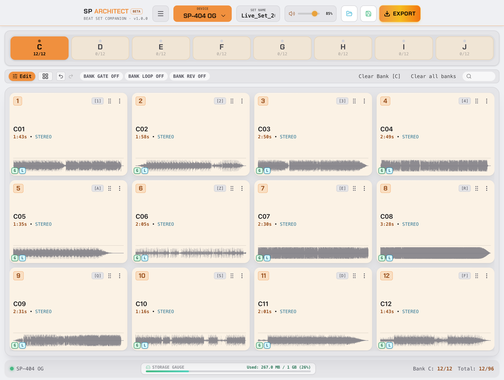 | **SP-404 OG** — a CompactFlash card read from disk, waveforms and gate/loop flags restored. |
| 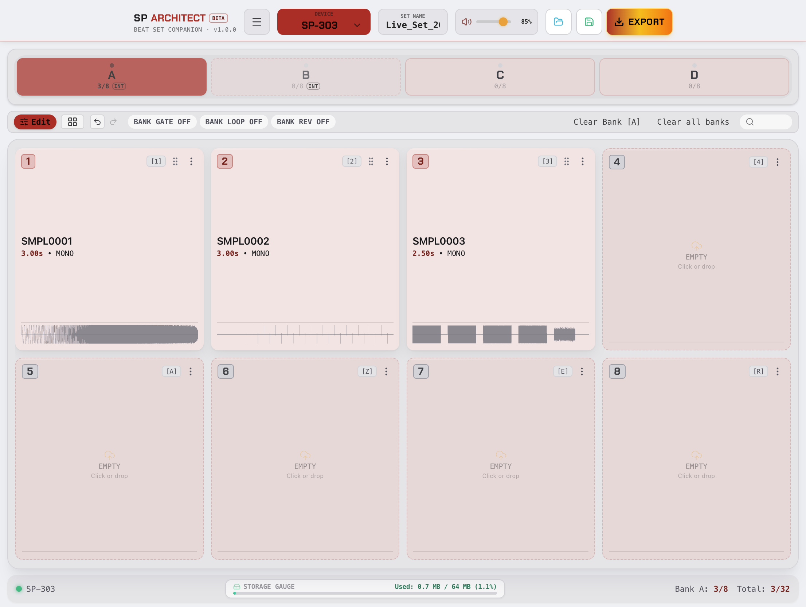 | **SP-303** — an original card opened, samples and pad layout rebuilt. |
| 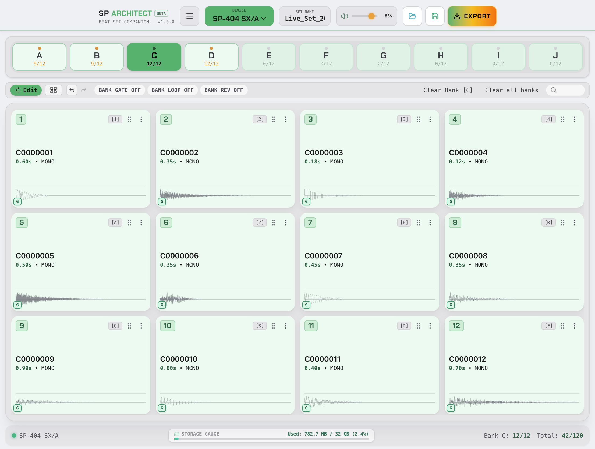 | **SP-404SX / A** — a full set from a card, 10 banks, storage gauge. |
| 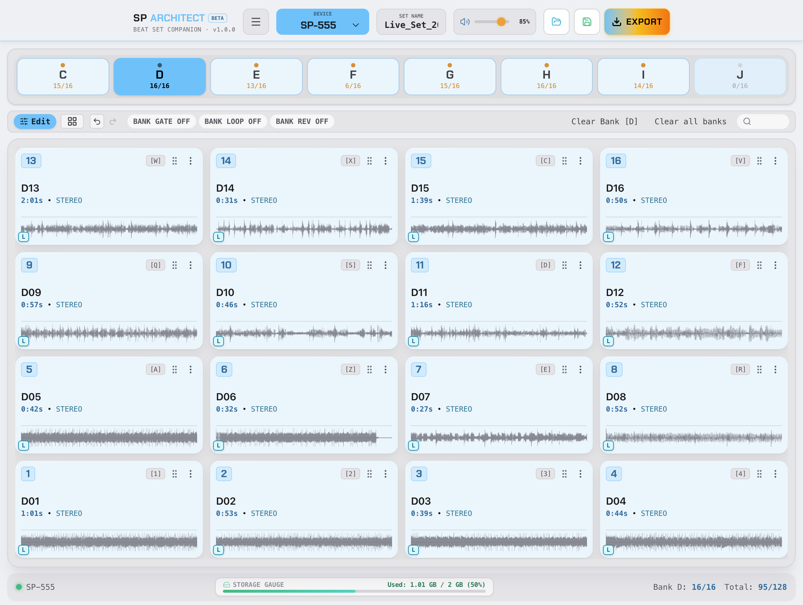 | **SP-555** — a real CompactFlash card: 95 of 128 pads, 1 GB used. |
| 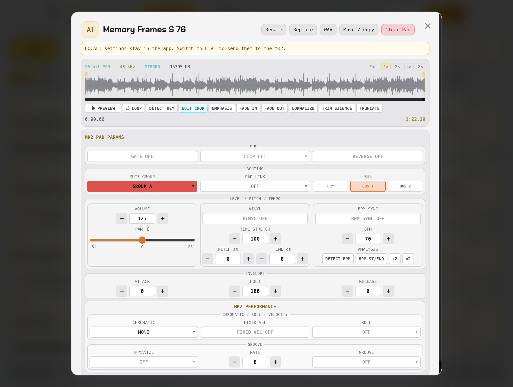 | **Pad Options** — waveform, level, pan, pitch, bus, mute group, envelope and the audio tools, in one panel. |
| 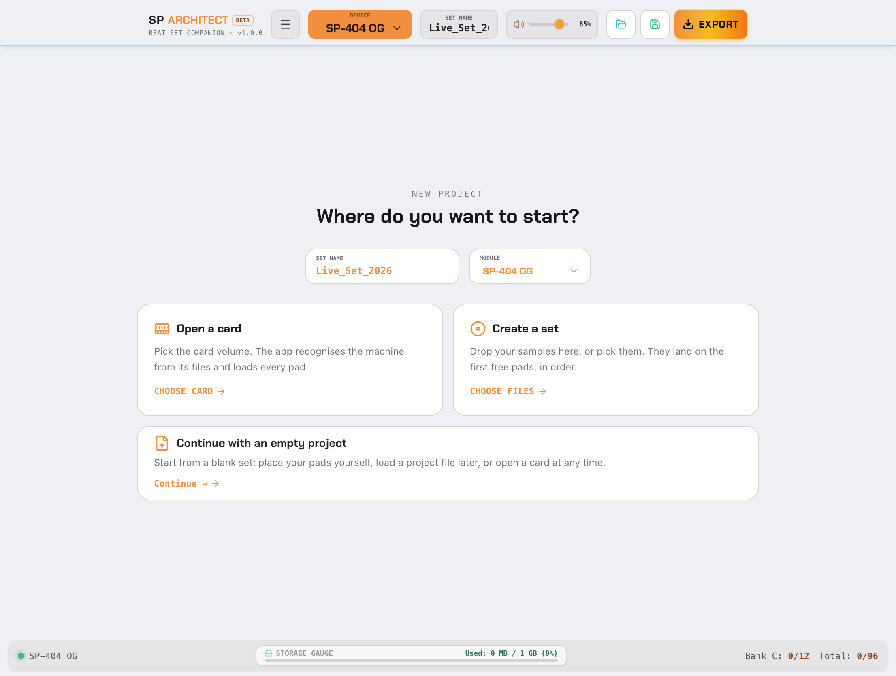 | **Start** — set name, module, then open a card, create a set or begin from a blank project. |
| 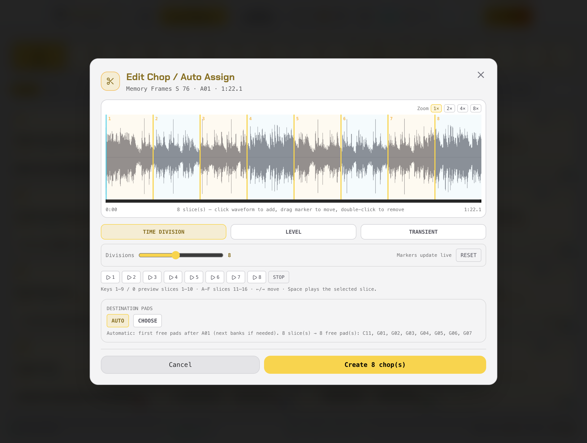 | **Chop (MK2)** — slices, keyboard audition and destination pads, in one window. |
| 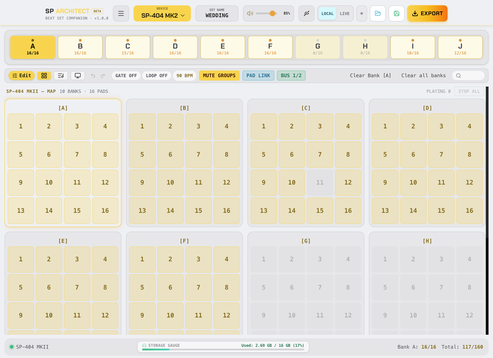 | **MAP** — all ten MK2 banks on one screen: filled pads bright, empty pads dimmed. |
| 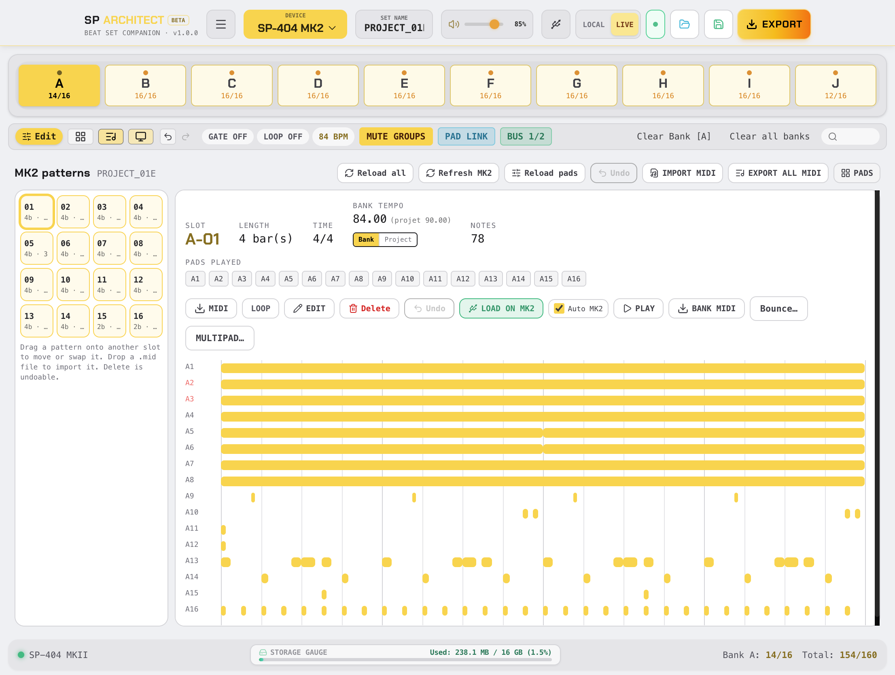 | **Patterns** — the MK2 project read in LIVE: grid, notes per pad, MIDI export, Bounce, MULTIPAD. |
| 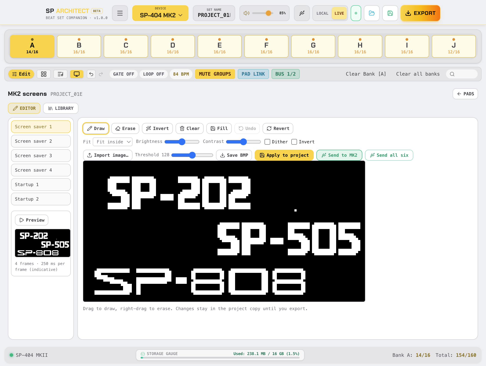 | **Screens** — six 128 × 64 images, pixel drawing, image import, send to the machine. |
| 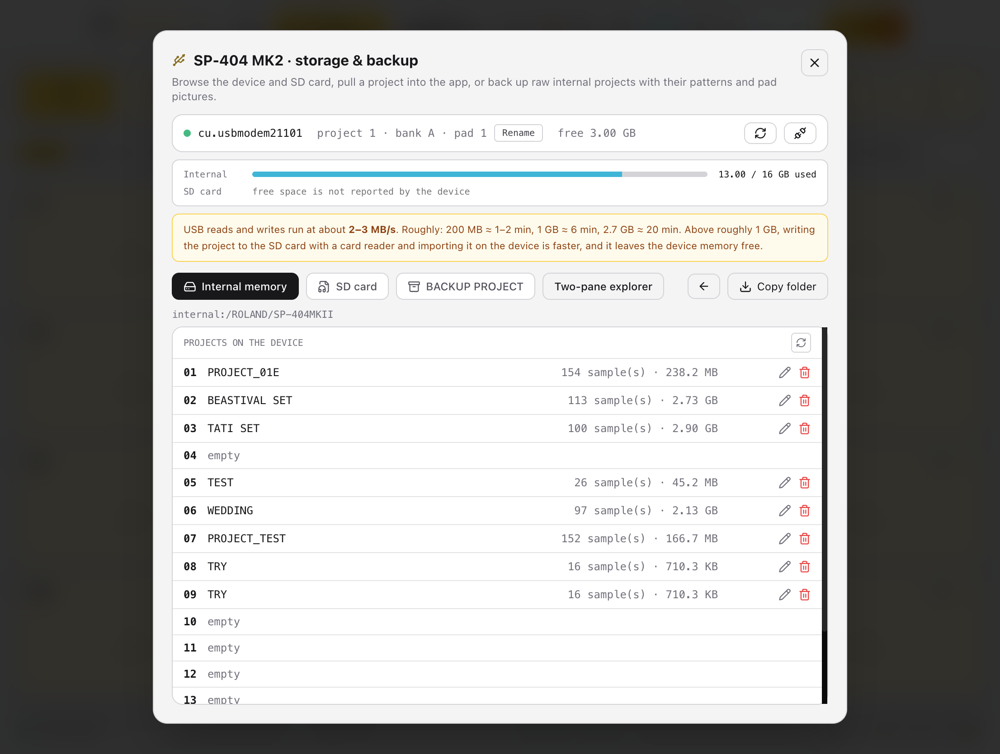 | **USB storage** — the machine's 16 projects with name, sample count and size; rename, delete, copy. |

*Pattern editor and screen editor captures are coming: they need the MK2
connected over USB (LIVE mode).*

## Overview (PDF)

Same content as this page, made to read or share offline:

- [SP-Architect-beta7-FR.pdf](SP-Architect-beta7-FR.pdf) — français, 15 pages
- [SP-Architect-beta7-EN.pdf](SP-Architect-beta7-EN.pdf) — English, 15 pages

## What it does

Common to every module — **SP-303, SP-404 (OG), SP-404SX / A, SP-404MK2 and SP-555**:

- **decode and import the machine's own cards**: open a real SD, CompactFlash or SmartMedia card (or a copy of it) and rebuild the set — samples, names, pad parameters, banks;
- prepare and organise a set, bank by bank, with notes, tempo and levels;
- edit every pad parameter of the machine (volume, pan, pitch, loop/gate, filter, AHR, routing…);
- drop **many files at once** — they fill the free pads in order;
- import WAV/AIFF/MP3/FLAC, resample and convert to the machine's own format;
- **drag a pad out** to the Finder, the desktop or a DAW track and get the WAV back;
- detect a sample's **BPM and key**, then follow the project tempo per pad;
- export to a card folder, a ZIP, or a self-contained project file.

### SP-404MK2 only

- **LOCAL / LIVE** link over USB: LOCAL keeps the app independent, LIVE mirrors the machine project;
- **Chop**: cut a sample into slices (time, level or transients), audition each one, create the pads in one go;
- pattern editor: read, edit, write and export patterns (MIDI, Bounce, MULTIPAD);
- screen editor: startup animation and screen saver, with a library of sets.

## Part by part

### 1. Set preparation (every module)

The pad grid is the workspace: one bank at a time, every pad showing the sample
name, level, pan, playback flags (gate/loop/reverse), and for the MK2 its bus,
mute group and tempo. Drag a pad to move it, drop files straight onto a pad,
or drop many files at once to spread them over the free pads of a bank.

A project file keeps the whole set together (pads, parameters, notes, tempo)
so a set can be prepared offline, duplicated for a variation, or archived.

### 2. Audio conversion (every module)

Import WAV, AIFF, MP3 or FLAC. Each module gets its own converter, so what you
drop is resampled, converted and named the way the machine expects — not just
copied as a WAV with a different extension.

### 3. Card reading (every module)

Open a real card (SD, CompactFlash, SmartMedia) or a card image already copied
to disk. The app reads the card structure and rebuilds the project: samples,
names, pad parameters, banks. Nothing is written back until you ask for it.

### 4. Export (every module)

- **Card folder** — the exact tree the machine expects, ready to copy.
- **ZIP** — the same tree in one archive, for backups and sharing presets.
- **Project file** — the app's own format, to reopen the set later.

Every write is a deliberate action, with a progress indicator; a card is never
modified in the background.

### 5. SP-303 and SP-404 (OG)

The two machines no other tool covers. Card structures (`SMPINFO0`,
`WVCINFO0`) are read and written, and samples are converted to the original
formats. Pad parameters can be edited once the card is open.

### 6. SP-404SX / A

Samples plus `PAD_INFO.BIN` are supported, with the SX/A conversion. Patterns
are **not** implemented yet — this is stated up front in the app and in the
release notes.

### 7. SP-404MK2

- **LOCAL / LIVE over USB** — LOCAL keeps the app independent; LIVE mirrors the
  machine project, with explicit refresh and verification after every write.
- **Patterns** — read, edit on a piano-roll style grid, write back, and export
  (MIDI file, Bounce to a pad, MULTIPAD to a bank, with pitch/sync/volume/pan).
- **Screens** — startup animation and screen saver, editable and stored in a
  library, exported as BMP or written to the machine.
- **Storage** — browse the MK2 storage, import from it, export to it.

### 8. SP-555

Card reading and writing, sample conversion (64-window format), and the same
set preparation as the other modules.

## Status

- macOS and Windows: **1.0.0** (beta label for the first public builds).
- iPad: **TestFlight beta** — editor/librarian, no USB link (iPadOS does not allow it).

Known limits:

- SP-404MK2 USB link is unavailable on iPad by design (iPadOS has no CDC-ACM access);
- SP-404SX / A patterns are not implemented (samples and `PAD_INFO.BIN` are);
- Windows builds are not code-signed.

## Credits

Thanks to the beta testers: **Owae.ga (thank you A LOT)**, Vinyl Sim Collective, 97Specials, Annawak, Flanders, Jesus Crise, Just Charly Brown, Mayaewk, Tohaj, Tsy and Zenover.

Formats and protocol were established from public documentation and our own readings of the machines. No third-party source code is included. See [THIRD-PARTY-NOTICES.md](THIRD-PARTY-NOTICES.md).

## Privacy

No data is collected. See [PRIVACY.md](PRIVACY.md).

## License

**Free of charge to use** as a compiled binary. The source code is not published
and is not distributed in any form.

Redistribution, resale, decompilation or reuse of the code requires written
permission — see [LICENSE.md](LICENSE.md) (summary) and [EULA.md](EULA.md)
(full text).
